# Ecological Society of America (ESA) Annual Meeting 2026

This year at ESA 2026 in Salt Lake City, Utah, I had the opportunity to organize a session, a workshop, as well as present my recent work on dung beetle reproductive behavior.
In addition, I got to be a [SEEDS](https://esa.org/seeds/) mentor to an incredible group of students.

## Organized Oral Session: Ecosystems response to drought in the Neotropics
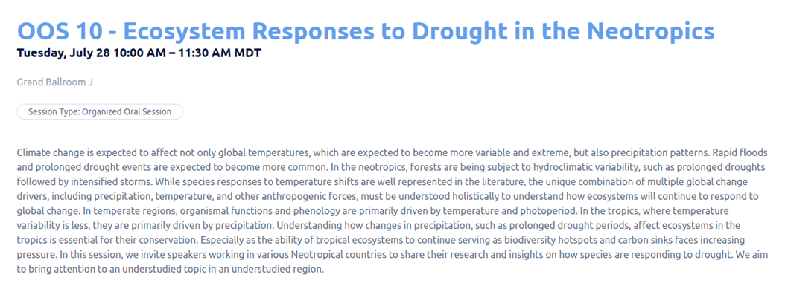

## Oral presentation

Talked about my recent work in the Sheldon lab on soil moisture & temperature effects on dung beetle reproductive behavior.

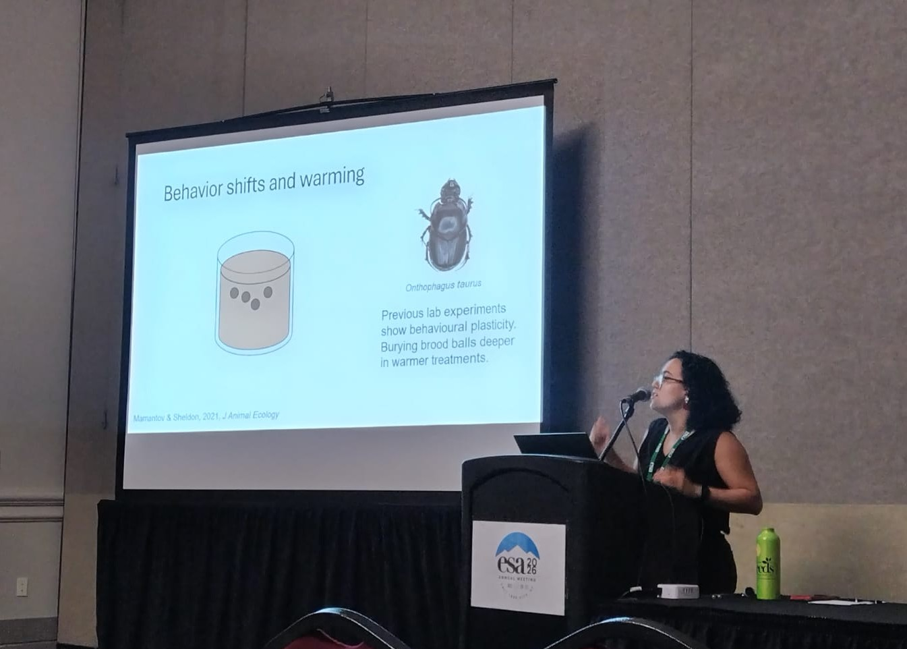

## Science communication workshop

From Research to Action: Communicating Science Effectively for Real-World Impact
In collaboration with Dr. Luis Y. Santiago and the Latin America and the Caribbean Chapter, we were able to make this into a recurring workshop at ESA.

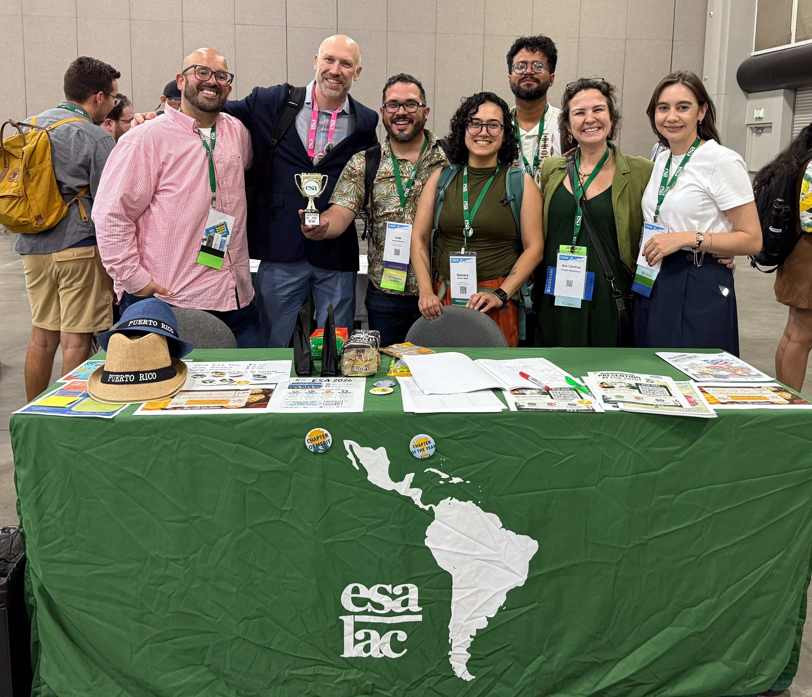

## SEEDS group of mentors and mentees 2026
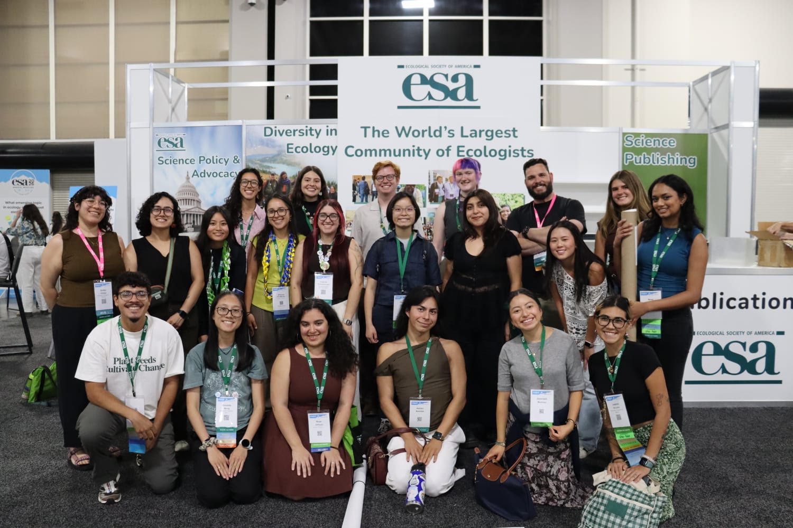
I had the opportunity to spend all week with an amazing group of SEEDS students, share about my experience in academia, and learn about their interests and experiences.

# ESA Great Lakes Regional Meeting 2026

Once again I had the opportunity to be part of the planning committee for the ESA GL Chapter Regional meeting in Cleveland, Ohio. Here, I also got to present my dung beetle work for the first time. 

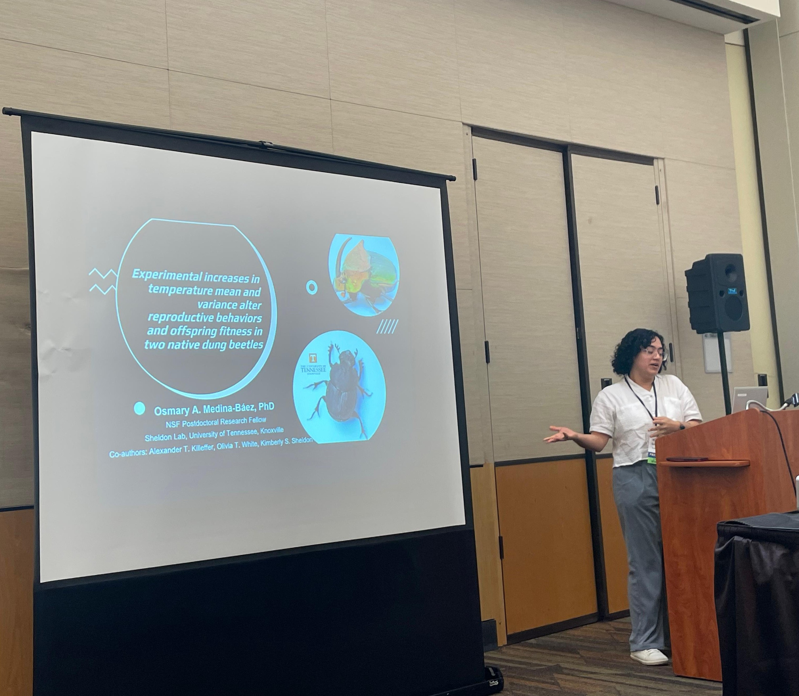

# ESA 2025

## Science communication workshop

At the Ecological Society of America meeting 2025 in Baltimore, Maryland I had the opportunity to participate in a science communication workshop (From Research to Action: Communicating Science Effectively for Real-World Impact) sponsored by the Latin America and the Caribbean Chapter, where I got to share some of my science communication skills, especially through media.  

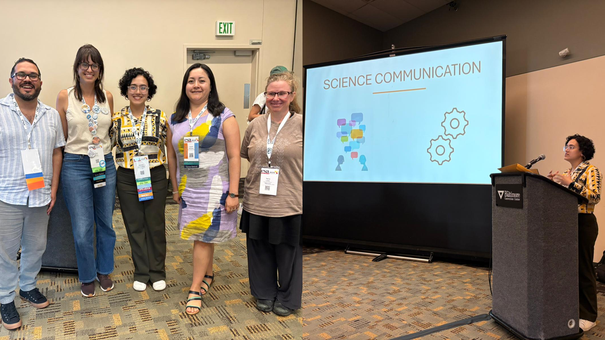

## Poster presentation

I also had the opportunity to present my recent work on butterfly-hostplant habitat suitability modeling and received a lot of great feedback.

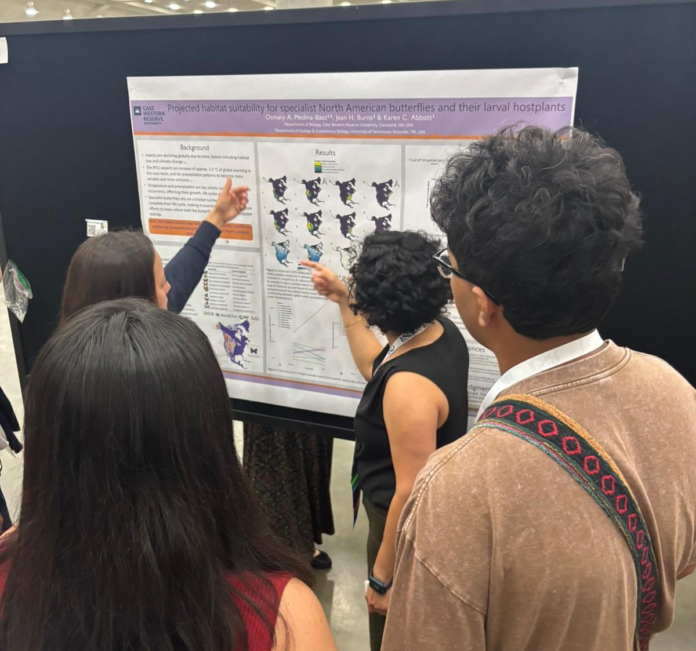

## SEEDS Alumni mentor
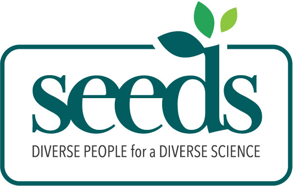

For the first time, I had the opportunity to be a [SEEDS](https://esa.org/seeds/) Alumni mentor for current SEEDS students. It was an amazing opportunity where I learned from so many talented students and was able to help them navigate their first big conference. 

# ESA 2024

At the Ecological Society of America meeting 2024 in Long Beach, California I had the opportunity to be an organizer and speaker at the Special Session *Towards equity in the communication of science: harnessing the power of AI for an inclusive tomorrow*. 
I presented my work (titled: ¿Qué herramientas ayudan ante el cambio? Physiological tolerances as a tool to assess butterfly vulnerability to climate change) in my native language (Spanish) while using AI interpretation. 

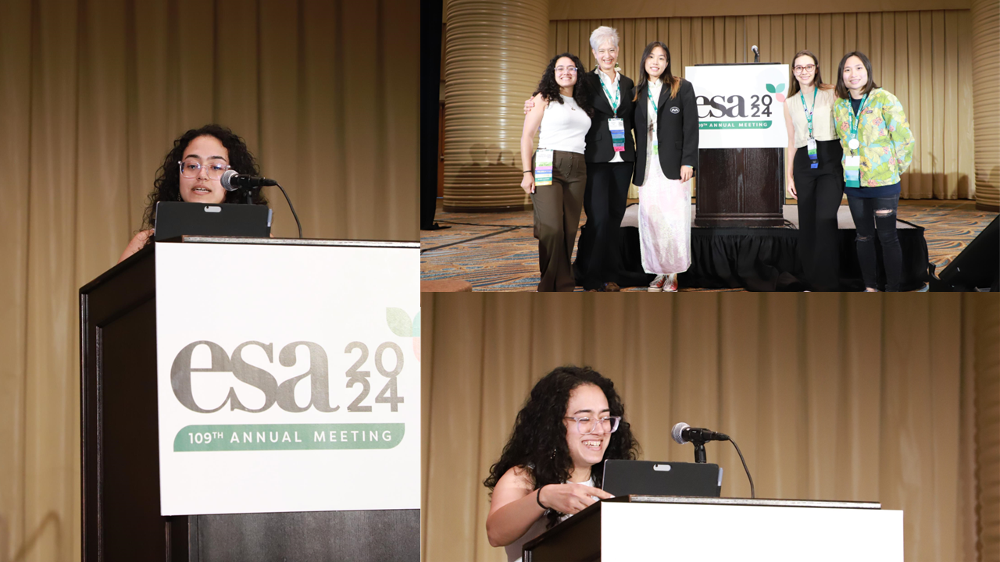

# ESA Great Lakes Regional Meeting 2024

Not only did I have the opportunity to participate in the planning committee for the ESA Great Lakes Conference 2024 as the program director, but I also got to present my current work on thermal physiology of butterflies in Ohio. 

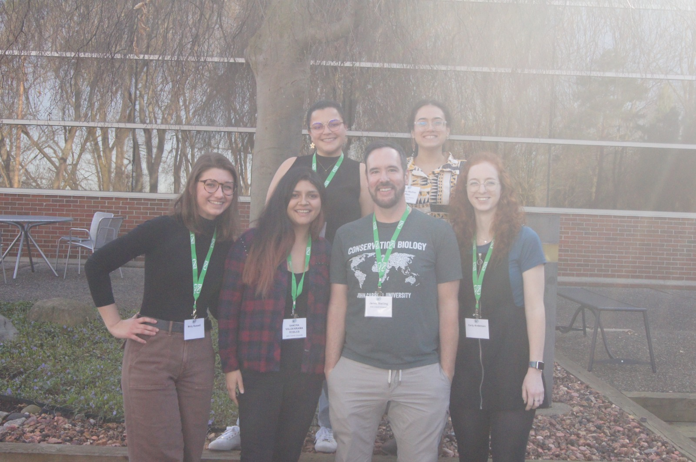
Current and past members of the Watling lab reunite at ESA Great Lakes Regional Conference 2024

::: {layout-ncol=1}

# ESA 2023

At the Ecological Society of America meeting 2023 I got to present my ongoing work on butterfly thermal physiology, as well as serve as the organizer of an Inspire session focused on the experiences of the Latine community of ecologists.

## Poster presentation 

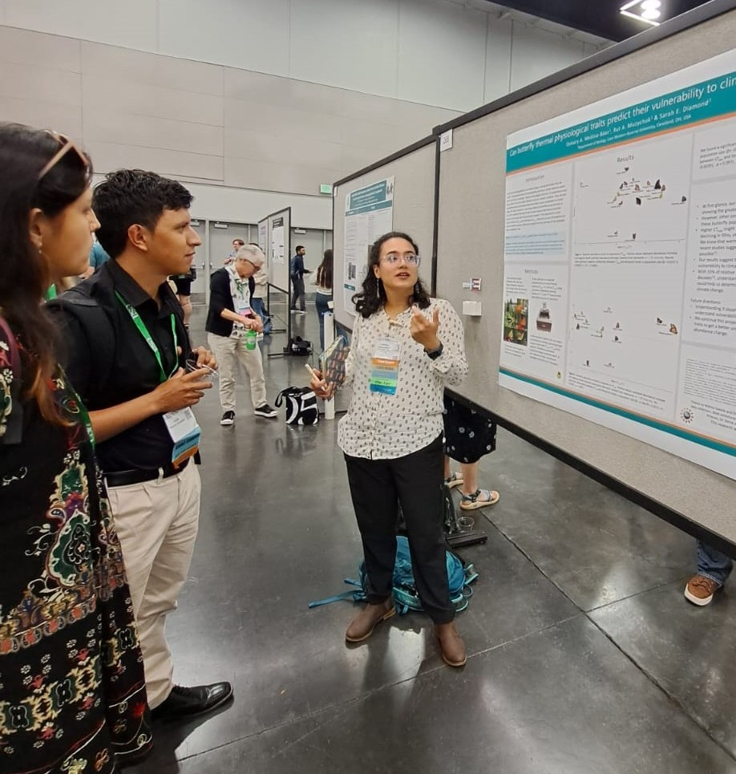

Presenting my work on thermal physiology of butterflies at the poster session.

## Inspire Session

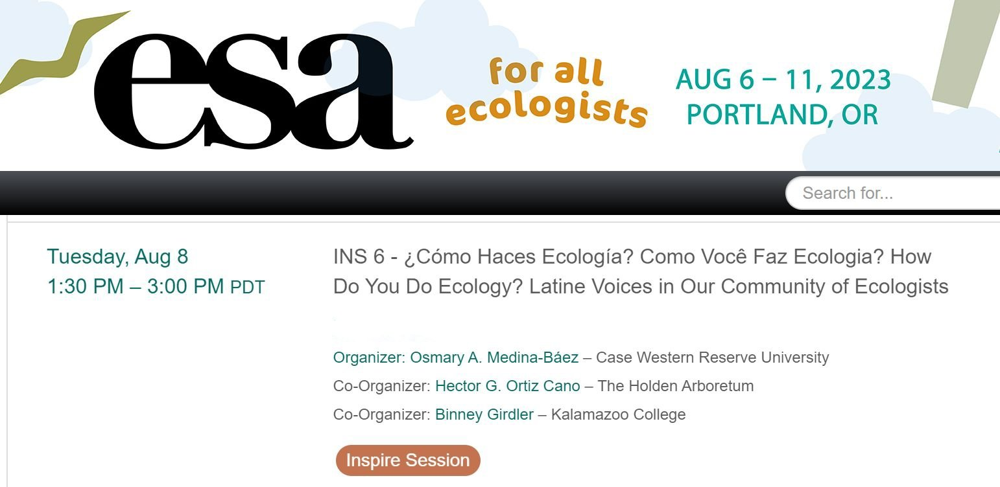

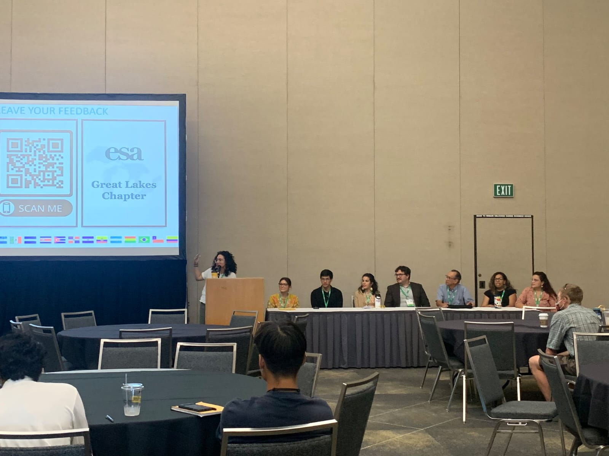

Introducing the awesome speakers at the Inspire session.

:::

