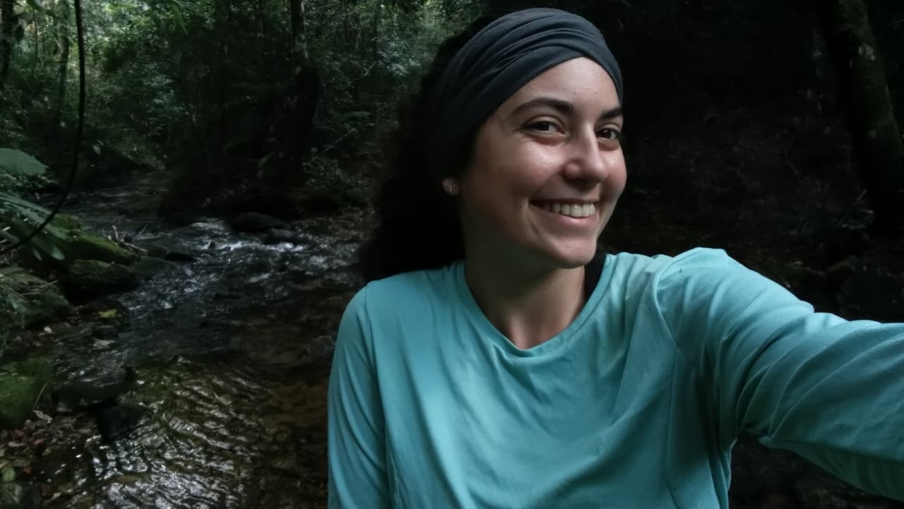

# Current students

## University of Puerto Rico
I currently have the opportunity to mentor several amazing students at the University of Puerto Rico along with Dr. Adrianne Tossas and Dr. Alejandro Ríos.

### Adrián Y. González Rivera (2026-present)

Adrián is a student at UPR-Cayey working with our butterfly team in Puerto Rico understanding species' physiological limitations to severe climate. I have also had the opportunity to mentor Adrián as a [ESA SEEDS](https://esa.org/seeds/) mentor during the ESA Annual Meeting 2026. 

### Manuel A. Ramos Feliciano (2026-present)

Manuel is a student at UPR-Ponce working with our butterfly team in Puerto Rico understanding species' physiological limitations to severe climate. Manuel is really interested in insects and their microbiome.

### Leonardo Y Rodríguez Dávila (2026-present)

Leonardo is a student at UPR-Ponce working with our butterfly team in Puerto Rico understanding species' physiological limitations to severe climate. As you can see in this picture, Leonardo is really interested in arachnids!

## Universidade Estadual de Campinas (UNICAMP)
I am a mentor to a PhD student (first one) in Brazil in collaboration with Dr. André Victor Lucci Freitas and Dr. Kimberly Sheldon 

### Letícia Carlesso de Paula Sena (2026-present)

Letícia is a 2nd year PhD student in the Freitas lab at UNICAMP. Her project in Brazil investigates how spatial and temporal dynamics drive diversity patterns in tropical fruit-feeding butterflies. Specifically, we evaluate how vertically stratified species may respond to climate change across different years and forest strata.She is now incorporating ecophysiology to understand how vertical stratification modulates species' responses and unravel their differential vulnerability.

## University of Tennessee, Knoxville

I am a mentor to several amazing students in the Sheldon Lab. We are developing several projects, from dung beetle behavior responses to environmental variables, to using herbarium specimens to better understand larval host plants.

### Myles Nellans (2026-present)
 
Myles is working on better understanding butterfly-hostplant interactions in order to be able to rear butterflies in captivity.

### Nathan Rhodes (2026-present)

Nathan is working on field and laboratory experiments to better understand butterfly physiological traits.

### Gracie Bixler (2026-present)

Gracie studies dung beetle reproductive behavior in response to environmental variables.

# Former students

## University of Tennessee, Knoxville

### Emily Sexton (2025-2026)

As an undergrad, Emily was the lead in lab experiments looking at dung beetle reproductive behavior in response to environmental variables. She is currently a PhD student at the University of Arkansas.

### Emily Wagner (2026)

Emily worked on field and laboratory experiments to better understand butterfly physiological traits.

## Case Western Reserve University

### Rut Muzychuk (2021-2023)

Rut worked with me since the beginning of my PhD. She was the first student I had the opportunity to mentor, so we were both learning together. Hard worker and enthusiastic, she got to present at a national conference and she is a co-author in all the butterfly physiology work done at CWRU. Rut graduated in 2024 and is now enrolled in a Master's program at CWRU. 

### Wei Chen (2024-2025)

Wei worked with me during 2024-2025 as part of his capstone project. He is creative, hard worker and innovative. He was able to adapt plant software to conduct butterfly wing analysis. He graduated from CWRU in 2025 and has just started a Master's program working with salamanders in Michigan. 

### Ahalya Pandian (2024)

Ahalya worked with me the summer of 2024 while she was in high school. She has a lot of curiosity for science and is always excited to learn new things. She graduated from Solon High School and just started her undergraduate studies at The Ohio State University.

